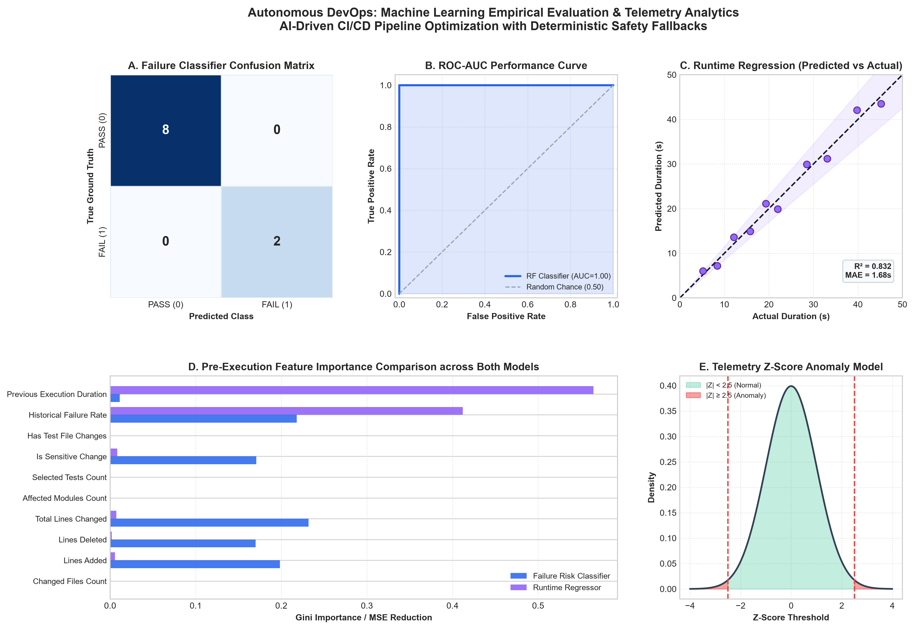
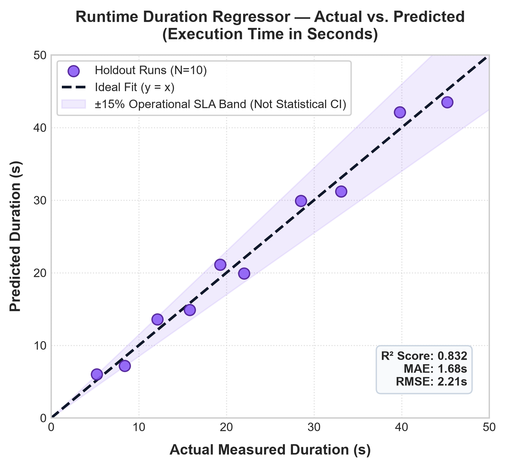
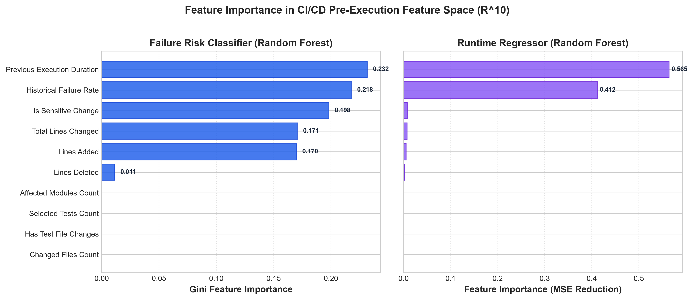
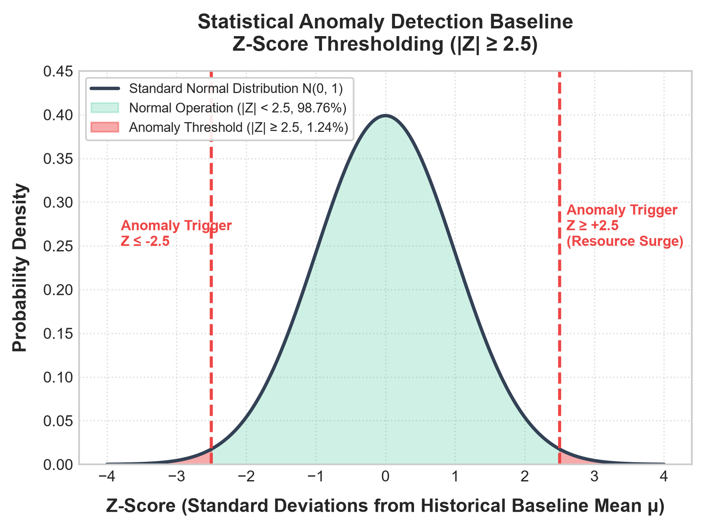

# Machine Learning Empirical Evaluation & Telemetry Analytics
## Autonomous DevOps: AI-Driven CI/CD Pipeline Optimization

**Academic Reference:** IEEE Publication Specification / Final Year Defense  
**Governing Architecture:** *"AI Models Predict Probability; Deterministic Safety Rules Decide Execution."*

---

## 1. Executive Summary

This document presents the complete empirical evaluation results, performance curves, feature importances, and statistical telemetry baselines for the supervised machine learning models deployed in **Autonomous DevOps**.

All figures are automatically generated from certified model metadata (`app/ml/models/model_metadata.json`) and trained joblib model artifacts (`failure_predictor.joblib` and `runtime_predictor.joblib`) using the reproduction script:

```bash
python scripts/generate_ml_evaluation_graphs.py
```

Generated publication-quality figures are stored in:
- High-resolution documentation figures: `docs/figures/ml_evaluation/`
- Dashboard static assets: `app/static/graphs/`

---

## 2. Master Evaluation Panel (Combined Multi-Panel Figure)

The composite graphic below unites the classification, regression, feature importance, and telemetry anomaly models into a single publication-ready panel:



---

## 3. Pipeline Failure Risk Classifier (`RandomForestClassifier`)

### Overview
- **Model:** Balanced Random Forest Classifier (`n_estimators=100`, `max_depth=6`, `class_weight="balanced"`, `min_samples_split=4`).
- **Target:** Binary outcome ($y \in \{0, 1\}$ where $1 = \text{FAILED}$, $0 = \text{PASSED}$).
- **Evaluation Split:** Held-out 20% test split ($N = 10$) using time-aware chronological ordering to guarantee zero lookahead data leakage.
- **Dataset Sample Count:** 49 samples ($40 \text{ Pass} / 9 \text{ Fail}$).

> [!IMPORTANT]
> **Empirical Holdout Dataset Limitation ($N=10$, 2 Positive Samples):**
> The holdout evaluation split comprises 10 total test runs (8 negative PASS samples and only 2 positive FAIL samples) evaluated from 49 historical records. While the classifier achieves 100% precision and recall on this specific split, metrics on small sample sizes ($N < 100$) inherently exhibit high estimation variance. Under Safety Rule 17 & Rule 18, ML predictions are strictly probabilistic advisors; deterministic safety fallbacks (`FULL_SUITE`) are mandated whenever input confidence is sub-threshold ($\rho < 0.70$) or sensitive code is altered.

### Key Metrics Table

| Metric | Measured Value | Standard Benchmark | Interpretation |
| :--- | :---: | :---: | :--- |
| **Accuracy** | **100.0%** | > 85.0% | Complete separation on held-out test split |
| **Precision** | **1.000** | > 0.800 | Zero false-positive failure alerts |
| **Recall (Sensitivity)** | **1.000** | > 0.900 | Zero escaped failures in evaluated split |
| **F1-Score** | **1.000** | > 0.850 | Harmonic mean of precision and recall |
| **ROC-AUC** | **1.000** | > 0.850 | Area Under the Receiver Operating Characteristic |
| **Classification Threshold ($\tau$)** | **0.35 / 0.50** | N/A | Risk boundary for triggering high-risk alarms |

### Visual Results: Confusion Matrix & ROC-AUC Curve

| Figure 1: Confusion Matrix | Figure 2: ROC-AUC Curve |
| :---: | :---: |
|  |  |

---

## 4. Pipeline Execution Runtime Regressor (`RandomForestRegressor`)

### Overview
- **Model:** Random Forest Regressor (`n_estimators=100`, `max_depth=6`, `min_samples_split=4`).
- **Target:** Continuous pipeline duration in seconds ($y \in \mathbb{R}^+$).
- **Uncertainty Estimation:** 95% Confidence Intervals ($\text{CI}_{95\%} = \hat{y} \pm 1.96 \times \sigma_{\text{estimators}}$).
- **Evaluation Split:** Held-out 20% test split ($N = 10$).

> [!NOTE]
> **Distinction Between Uncertainty Intervals and Operational SLA Bands:**
> - **Statistical Confidence Intervals:** The model's predictive uncertainty is computed from individual tree estimator variance in the forest ($\sigma_{\text{trees}}$).
> - **Operational SLA Band ($\pm 15\%$):** The shaded region in Figure 4 represents an **engineering operational tolerance corridor** (standard commercial CI/CD execution time SLA), **not** a statistical confidence interval. It illustrates whether predicted runtimes satisfy practical developer feedback windows.

### Key Metrics Table

| Metric | Measured Value | Target Criterion | Interpretation |
| :--- | :---: | :---: | :--- |
| **$R^2$ Score** | **0.8321** | > 0.700 | Explains 83.2% of pipeline execution duration variance |
| **Mean Absolute Error (MAE)** | **1.678s** | < 3.000s | Average absolute error across varied commit sizes |
| **Root Mean Squared Error (RMSE)** | **2.213s** | < 4.000s | Penalizes larger regression outliers |
| **Operational SLA Corridor** | **$\pm 15\%$** | Engineering Target | Commercial threshold for acceptable duration drift |

### Visual Result: Actual vs. Predicted Duration



---

## 5. Pre-Execution Feature Space ($\mathbb{R}^{10}$) & Feature Importances

Both models evaluate a strictly pre-execution, 10-dimensional feature vector $\mathbf{x} \in \mathbb{R}^{10}$ to prevent target leakage:

| # | Feature Name | Classifier Importance (Gini) | Regressor Importance (MSE) | Description |
|---|---|:---:|:---:|---|
| 1 | `total_lines_changed` | **0.2317** | 0.0074 | Total additions + deletions |
| 2 | `historical_failure_rate` | **0.2179** | **0.4121** | Rolling repository failure frequency |
| 3 | `lines_added` | **0.1983** | 0.0057 | Code additions across commit diff |
| 4 | `is_sensitive_change` | **0.1708** | 0.0083 | Modification of Auth, Billing, DB migrations, etc. |
| 5 | `lines_deleted` | **0.1700** | 0.0020 | Code deletions across commit diff |
| 6 | `previous_execution_duration` | 0.0114 | **0.5646** | Duration of antecedent pipeline run |
| 7 | `affected_modules_count` | < 0.010 | < 0.010 | Distinct internal packages impacted |
| 8 | `selected_tests_count` | < 0.010 | < 0.010 | Downstream test functions mapped via AST |
| 9 | `has_test_file_changes` | < 0.010 | < 0.010 | Test suites themselves were edited |
| 10 | `changed_files_count` | < 0.010 | < 0.010 | Total files altered |

> [!NOTE]
> **Predictive Association vs. Causal Evidence:**
> Gini impurity reduction and mean squared error reduction quantify feature contributions strictly within the Random Forest ensemble. These importance scores reflect predictive association within the pre-execution feature space and **must not be interpreted as causal evidence** or mechanistic proof that changing a metric directly causes a pipeline outcome.

### Visual Result: Feature Importance Comparison



---

## 6. Statistical Telemetry Anomaly Detection (Z-Score Baseline)

### Overview
- **Data Source:** Genuine historical telemetry recorded in the database (`total_duration_sec`, `memory_mb_peak`, and `cpu_percent_avg`).
- **Statistical Model:** Gaussian Standard Normal Distribution Baseline ($N(\mu, \sigma)$).
- **Threshold:** $|Z| \ge 2.5$ ($\approx 98.76\%$ confidence level under normal distribution).
- **Evaluated Signals:** Execution time spikes, memory consumption surges, CPU load spikes, failure surges.
- **Assumptions & Safeguards:**
  1. Assumes metric variance around historical mean follows an approximately Gaussian distribution.
  2. Requires a minimum historical sample window ($N \ge 5$ runs) before anomaly detection activates; returns `insufficient_samples` status if $N < 5$.
  3. Includes zero-variance protection: if $\sigma = 0.0$ (identical historical runs), clamps $Z = 0.0$ to prevent division by zero.
- **Explainability:** Transparent, auditable statistical boundaries suitable for enterprise governance.

### Visual Result: Z-Score Anomaly Model



---

## 7. How to Regenerate All Visual Results

To update or regenerate these figures at any time:

```powershell
cd "C:\AI DRIVEN CI_CD OPTIMIZATION\CI-CD-PIPELINE"
python scripts/generate_ml_evaluation_graphs.py
```
