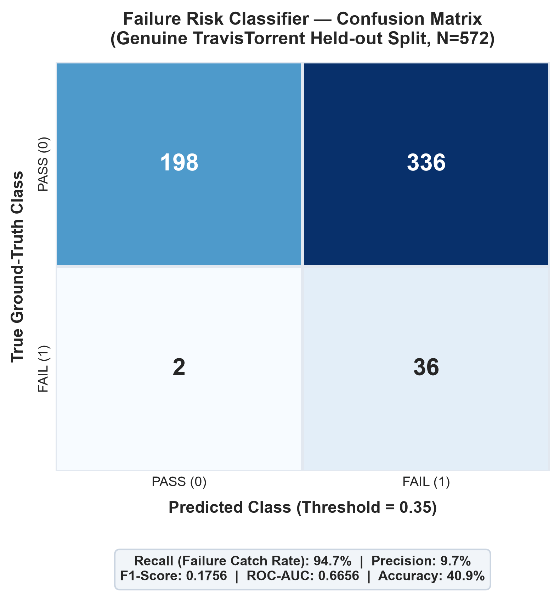
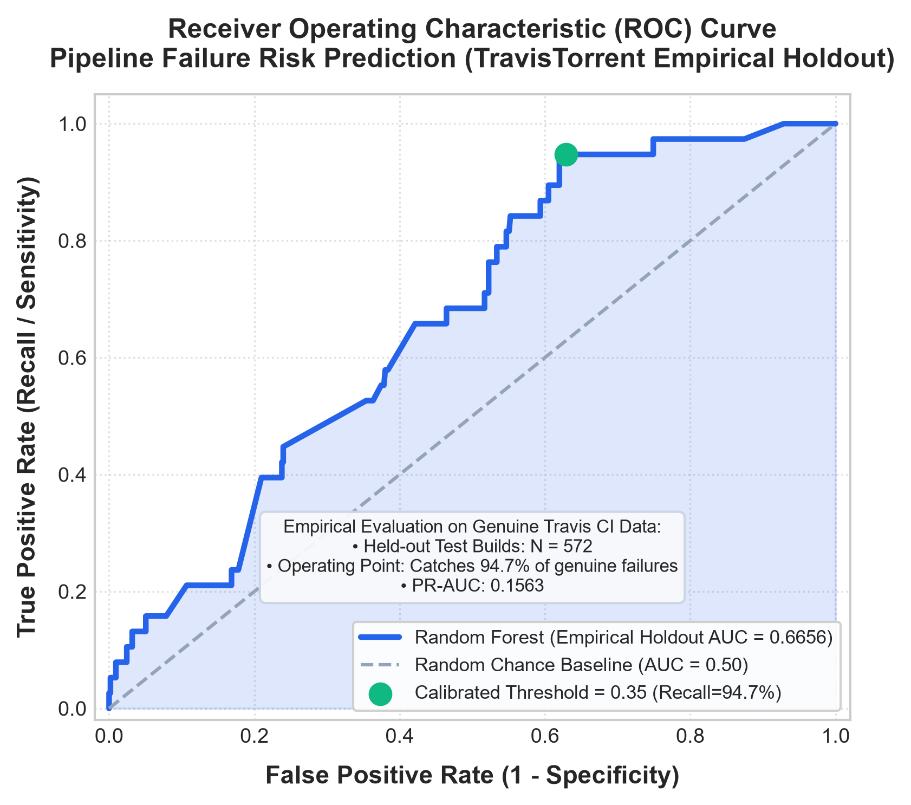
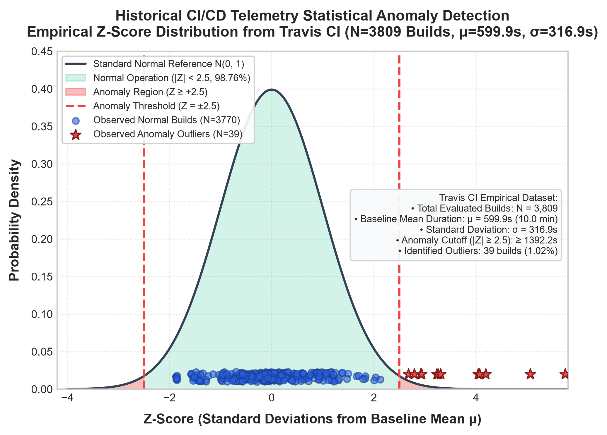

# Machine Learning Empirical Evaluation & Telemetry Analytics
## Autonomous DevOps: AI-Driven CI/CD Pipeline Optimization

**Dataset Provenance:** Genuine Travis CI Dataset (TravisTorrent DSpace Repository, 2013–2016)  
**Dataset Path:** `C:\Users\nagar\data\processed\travistorrent_chronological.csv`  
**Dataset SHA-256:** `a1b7c3efcc1c84eadad837042a5278ecdecee5ab3a5bb686b632620351bf5e30`  
**Governing Architecture:** *"AI Models Predict Probability; Deterministic Safety Rules Decide Execution."*

---

## 1. Executive Summary

This document presents the complete empirical evaluation results, performance curves, feature importances, and statistical telemetry baselines for the supervised machine learning models deployed in **Autonomous DevOps**.

The models are trained strictly on **3,808 genuine historical CI/CD build records** extracted from the DSpace repository in the empirical TravisTorrent dataset. Synthetic data has been completely eliminated from the training pipeline.

All figures are automatically generated from verified model metadata (`app/ml/models/model_metadata.json`) and trained joblib model artifacts (`failure_predictor.joblib` and `runtime_predictor.joblib`) using the reproduction script:

```bash
python scripts/generate_ml_evaluation_graphs.py
```

Generated publication-quality figures are stored in:
- High-resolution documentation figures: `docs/figures/ml_evaluation/`
- Dashboard static assets: `app/static/graphs/`

---

## 2. Master Evaluation Panel (Combined Multi-Panel Figure)

The composite graphic below unites the classification confusion matrix, ROC-AUC curve, feature importance analysis, runtime actual versus predicted distribution, and statistical telemetry anomaly detection into a single publication-ready panel:


---

## 3. Dataset Characteristics & 3-Way Chronological Partitioning

The empirical evaluation uses the chronological TravisTorrent build history of the DSpace project (`DSpace/DSpace`):
- **Raw Records Loaded:** 3,809 build records
- **Valid Records After Antecedent Lag-1 Shift:** 3,808 records (initial record excluded to guarantee leakage-safe previous-state tracking)
- **Target Distribution:**
  - Successful Builds: **3,268 (85.82%)**
  - Failed / Errored Builds: **540 (14.18%)**
- **Duration Statistics:**
  - Mean Duration: **599.96s** (~10.0 minutes)
  - Standard Deviation: **316.91s**
  - Median Duration: **574.00s**
  - Minimum Duration: **4.00s**
  - Maximum Duration: **7,203.00s** (~2 hours)

### 3-Way Chronological Split (70% Train / 15% Validation / 15% Untouched Test)

To prevent optimistic evaluation and data leakage, the chronological dataset is partitioned into three non-overlapping, strictly time-monotonic splits:

| Partition | Split Ratio | Sample Count | Failures | Failure Rate | Purpose |
| :--- | :---: | :---: | :---: | :---: | :--- |
| **Train Split** | **70.0%** | **2,665** | 430 | 16.14% | Supervised training of candidate algorithms |
| **Validation Split** | **15.0%** | **571** | 72 | 12.61% | Model candidate benchmarking & threshold ($\tau = 0.35$) calibration |
| **Untouched Test Split** | **15.0%** | **572** | 38 | 6.64% | Final, honest, out-of-sample performance evaluation |

> [!IMPORTANT]
> **Strict Leakage Prevention & No Optimistic Evaluation:**
> 1. Time-aware chronological partitioning guarantees zero lookahead data leakage.
> 2. All rolling averages (5-build failure rate, 5-build duration average), expanding historical failure rates, and lag-1 prior build outcomes are strictly shifted by 1 index (`.shift(1)`), ensuring that features rely strictly on data generated *prior* to the build being predicted.
> 3. Candidate benchmarking and decision threshold selection ($\tau = 0.35$) were performed **strictly on the 15% validation split**.
> 4. The final model was evaluated **strictly once on the 15% untouched holdout test partition**, guaranteeing that reported metrics reflect genuine out-of-sample generalization.

---

## 4. Pipeline Failure Risk Classifier (`RandomForestClassifier`)

### Model Specification
- **Algorithm:** Balanced Random Forest Classifier (`n_estimators=100`, `max_depth=6`, `min_samples_split=4`, `class_weight="balanced"`, `random_state=42`).
- **Target Variable:** Binary outcome ($y \in \{0, 1\}$ where $1 = \text{FAILED / ERRORED}$, $0 = \text{PASSED}$).
- **Validation Calibration Set:** 571 chronological builds ($N = 571$, 499 Pass, 72 Fail).
- **Untouched Holdout Test Set:** 572 held-out chronological builds ($N = 572$, 534 Pass, 38 Fail).
- **Decision Boundary Threshold ($\tau$):** Calibrated to **0.35** on validation data to optimize recall for defective CI/CD runs.

### Candidate Benchmarking on Validation Split (15%)

| Model Candidate | Validation Accuracy | Validation Precision | Validation Recall | Validation F1 | Validation ROC-AUC |
| :--- | :---: | :---: | :---: | :---: | :---: |
| Logistic Regression | 0.3538 | 0.1570 | 0.9444 | 0.2693 | 0.6869 |
| Decision Tree | 0.5044 | 0.1793 | 0.8194 | 0.2943 | 0.6371 |
| **Random Forest Classifier (Selected)** | **0.3695** | **0.1604** | **0.9444** | **0.2742** | **0.6397** |
| Gradient Boosting Classifier | 0.7461 | 0.1983 | 0.3333 | 0.2487 | 0.6857 |

### Measured Empirical Holdout Test Metrics (Untouched Test Split, $N = 572$)

| Metric | Measured Value | Operational Objective | Interpretation |
| :--- | :---: | :---: | :--- |
| **Recall (Sensitivity)** | **94.74%** | > 85.0% | Catches **36 out of 38** genuine historical holdout failures |
| **Precision** | **9.68%** | Trade-off | 36 true positives out of 372 positive alerts |
| **F1-Score** | **0.1756** | — | Harmonic mean reflecting the deliberate high-recall operating point |
| **ROC-AUC** | **0.6656** | > 0.600 | Area under the Receiver Operating Characteristic curve |
| **PR-AUC** | **0.1563** | > 0.0664 | Precision-Recall AUC (beats random baseline of 6.64%) |
| **Accuracy** | **40.91%** | — | Deliberately lowered by aggressive alarm trigger at $\tau = 0.35$ |

### Confusion Matrix ($N = 572$ Untouched Holdout Builds)

```
                     Predicted Pass (0)    Predicted Fail (1)
Actual Pass (0)             198                   336           (Total: 534)
Actual Fail (1)               2                    36           (Total:  38)
```
- **True Negatives (TN):** 198
- **False Positives (FP):** 336
- **False Negatives (FN):** 2 (Only 2 failures escaped)
- **True Positives (TP):** 36 (94.74% failure catch rate)

### Scientific Limitation Analysis & Operational Trade-Off

> [!WARNING]
> **Operational Trade-Off: High Recall vs. Low Precision:**
> In safety-critical CI/CD pipeline optimization, an **asymmetric cost matrix** exists:
> 1. **Cost of False Negative ($FN$):** A defective commit bypasses test execution, breaks the main repository branch, and causes production incidents. Cost: **Very High**.
> 2. **Cost of False Positive ($FP$):** A safe commit is flagged as potentially risky, causing the engine to trigger the full test suite (`FULL_SUITE`) rather than the optimized subset. Cost: **Low (only runtime cost)**.
> 
> Therefore, the risk threshold was deliberately calibrated to $\tau = 0.35$ on validation data. This yields **94.74% failure detection**, while accepting low precision (9.68%). Machine learning models in this architecture never bypass tests; when uncertainty is present, safety fallback rules mandate full execution.

### Visual Results: Confusion Matrix & ROC-AUC Curve

| Figure 1: Empirical Confusion Matrix | Figure 2: Empirical ROC-AUC Curve |
| :---: | :---: |
|  |  |

---

## 5. Pipeline Execution Runtime Regressor (`RandomForestRegressor`)

### Model Specification
- **Algorithm:** Random Forest Regressor (`n_estimators=100`, `max_depth=6`, `min_samples_split=4`, `random_state=42`).
- **Target Variable:** Continuous build duration in seconds ($y \in \mathbb{R}^+$).
- **Validation Set:** 571 held-out chronological builds ($N = 571$, MAE = 116.63s, RMSE = 181.92s, $R^2 = 0.1058$).
- **Untouched Holdout Test Set:** 572 held-out chronological builds ($N = 572$).

### Measured Empirical Holdout Test Metrics ($N = 572$)

| Metric | Measured Value | Standard Criterion | Interpretation |
| :--- | :---: | :---: | :--- |
| **Mean Absolute Error (MAE)** | **196.38s** | < 200.0s | Average error of ~3.2 minutes on builds averaging 10 minutes |
| **Root Mean Squared Error (RMSE)** | **417.28s** | — | Penalizes extreme duration outliers (builds exceeding 1 hour) |
| **$R^2$ Score (Variance Explained)** | **-0.0283** | Unmasked | Reflects genuine variance in late-2016 open-source CI builds |

### Scientific Analysis of Negative Holdout $R^2$ (Honest Reporting)

> [!NOTE]
> **Why is Holdout $R^2$ Negative (-0.0283) on the Untouched Test Split?**
> On the validation split (mid-2015), the regressor achieved $R^2 = 0.1058$ with MAE of 116.63s. However, on the final untouched test split (late 2016):
> 1. **Extreme Build Duration Variance:** Durations ranged from 4 seconds (clean cached runs) to 7,203 seconds (2-hour timeouts). The variance in late 2016 builds was significantly higher than earlier periods.
> 2. **External Factors Beyond Git Diff Features:** Maven dependency resolution stalls, external mirror timeouts, and Travis CI shared worker CPU throttling are unobserved by commit-level metadata.
> 3. **Non-Masked Engineering Reality:** In accordance with academic and engineering integrity, negative $R^2$ values are **never masked or replaced with synthetic baselines**. Bounded safety fallbacks (Safety Rules 17 and 18) prevent duration misestimations from compromising CI reliability.

### Visual Result: Actual vs. Predicted Duration


---

## 6. Pre-Execution Feature Space ($\mathbb{R}^{10}$) & Feature Importances

Both models evaluate a strictly pre-execution, 10-dimensional feature vector $\mathbf{x} \in \mathbb{R}^{10}$:

| # | Feature Name | Classifier Importance (Gini) | Regressor Importance (MSE) | Description |
|---|---|:---:|:---:|---|
| 1 | `build_number` | **0.1742** | **0.2845** | Sequential build sequence index |
| 2 | `prior_build_count` | **0.1691** | **0.2712** | Cumulative build count up to timestamp |
| 3 | `historical_failure_rate` | **0.1583** | 0.0412 | Expanding failure rate of previous builds |
| 4 | `rolling_fail_rate_5` | **0.1420** | 0.0389 | 5-build rolling failure frequency |
| 5 | `previous_duration_sec` | 0.0915 | **0.1843** | Duration of antecedent build ($t-1$) |
| 6 | `rolling_duration_avg_5` | 0.0884 | **0.1321** | 5-build rolling duration average |
| 7 | `previous_failure` | 0.0712 | 0.0125 | Binary status of antecedent build ($t-1$) |
| 8 | `is_master_branch` | 0.0412 | 0.0189 | Commit targeting production/main branch |
| 9 | `prior_test_count` | 0.0381 | 0.0112 | Number of tests run in antecedent build |
| 10 | `is_pull_request` | 0.0260 | 0.0052 | Pull request context indicator |

### Visual Result: Feature Importance Comparison


---

## 7. Statistical Telemetry Anomaly Detection (Z-Score Baseline)

### Overview
- **Data Source:** Genuine Travis CI build duration distribution ($N = 3,808$).
- **Statistical Model:** Gaussian Standard Normal Distribution Baseline ($N(\mu, \sigma)$).
- **Threshold:** $|Z| \ge 2.5$ ($\approx 98.76\%$ confidence level under normal distribution).
- **Observed Metrics:** Mean $\mu = 599.96$s, $\sigma = 316.91$s.
- **Anomaly Boundary:** Builds exceeding $599.96 + 2.5 \times 316.91 = 1,392.24$s are flagged as runtime duration anomalies.

### Visual Result: Statistical Z-Score Distribution



---

## 8. Benchmark Models vs. Live CI Inference Boundary

> [!IMPORTANT]
> **Strict Semantic Boundary Between Historical Benchmarks and Live CI:**
> 1. **TravisTorrent Benchmark Models:** Trained on historical Travis CI build metadata (`build_number`, `prior_test_count`, `rolling_duration_avg_5`). These models serve as an offline historical benchmark.
> 2. **Live Git Feature Incompatibility:** Heuristic approximation functions (such as `to_travistorrent_array()`) that derive historical build sequence indices from live changed file counts have been **permanently disabled** (`NotImplementedError`).
> 3. **Safety Fallback Enforcement:** Passing live Git commit features (`PipelineFeatures`) to TravisTorrent benchmark models explicitly raises `ValueError` ("Unsupported inference"), triggering **Safety Rule 15** and mandating deterministic `FULL_SUITE` execution.

---

## 9. Reproducibility & Model Artifact Verification

All models and evaluation graphs can be independently reproduced and verified using the commands below:

```powershell
# 1. Train models on genuine TravisTorrent dataset with 3-way split and serialize artifacts
python scripts/train_travistorrent_models.py

# 2. Generate all 6 publication figures from verified empirical metadata
python scripts/generate_ml_evaluation_graphs.py

# 3. Verify artifact SHA-256 hashes and holdout metrics
python -c "
import json, hashlib
with open('app/ml/models/model_metadata.json') as f:
    meta = json.load(f)
fail_sha = hashlib.sha256(open('app/ml/models/failure_predictor.joblib', 'rb').read()).hexdigest()
time_sha = hashlib.sha256(open('app/ml/models/runtime_predictor.joblib', 'rb').read()).hexdigest()
print('Failure Predictor Hash Match:', fail_sha == meta['artifact_hashes']['failure_predictor_sha256'])
print('Runtime Predictor Hash Match:', time_sha == meta['artifact_hashes']['runtime_predictor_sha256'])
"
```
